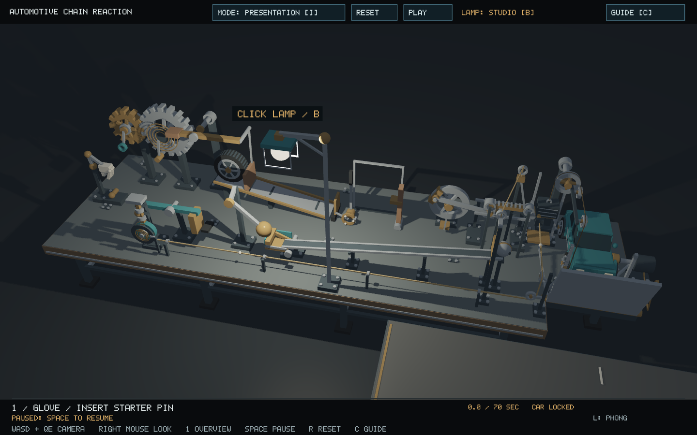
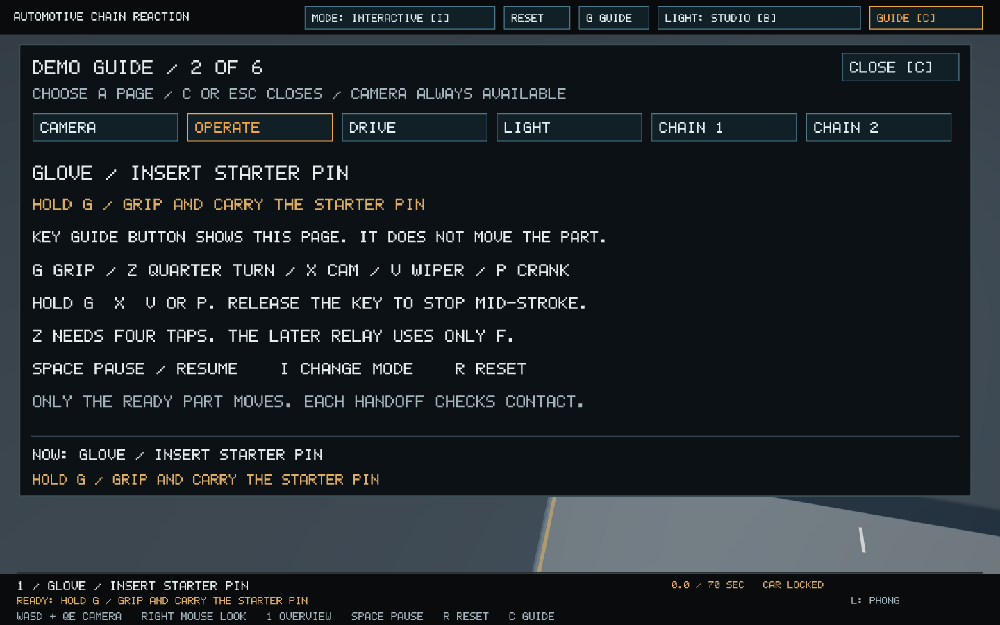

# Interactive Automotive Chain Reaction

**Mohammad Moin Uddin Moin | 2107111 | Computer Graphics**

A primitive-built OpenGL 3.3 machine with 17 connected actions and a drivable car. The presentation releases the car at **70 active seconds**. The rolling ball, cup, striker, rocker and pin relay has position/clearance guards, a visible spring-driven cable drum and larger contact surfaces.

The hanging striker now begins its swing as soon as the cup's retaining finger clears it (about 36.56 seconds), while the cup finishes tipping. There is no hold until the 39-second stage boundary. In interactive mode, the next F action continues that arc after the normal inspection pause. The stage schedule and 70-second car release stay the same.



## Run or submit

Use **submission/Automotive_Chain_Reaction_2107111** for the examiner, or extract its sibling ZIP. Double-click **START_PROJECT.bat** or **cog_demo.exe** in that folder. It contains one current executable, required runtime DLLs, source, headers, link libraries, build settings, current documentation and one set of review images. Older executables, backups and older preview generations are excluded.

In the development folder:

```powershell
mingw32-make build
.\cog_demo.exe
```

run.bat rebuilds and launches; VS Code Ctrl+Shift+B builds the same target. Rebuilding requires the existing MinGW compiler; running the packaged executable does not. Keep all packaged DLLs beside it. Windows with an OpenGL 3.3-capable driver is required. The development folder's main.exe is historical and is not included in the submission.

## Controls

Presentation starts automatically. At 70 seconds the car unlocks, then drives onto the apron over seven seconds. Arrows take over immediately after release. Press R, then Space, to replay. I switches mode and resets the machine/car.

| Control | Effect |
|---|---|
| WASD / Q-E | Free camera movement / down-up, even while paused |
| Hold right mouse / release | Look around / restore UI pointer |
| Left Shift / wheel | Faster camera / move closer or farther |
| 1 / 2 / 3 | Overview / crank / glove and gears |
| 4 / 5 / 6 | Car and apron / full front row / relay contacts |
| Arrows | Accelerate, brake/reverse, steer after car release |
| I / Mode | Switch presentation/interactive and reset |
| Space | Pause/resume; release a ready F action |
| R | Reset mechanisms, car, held input and queued gear turns |
| F / F GO button | Release a ready passive mechanism |
| G GUIDE / Z GUIDE / X GUIDE / V GUIDE / P GUIDE | Open the current operation's guide; the button does not pretend to perform a held/tapped action |
| C / Guide | Open six-page guide: Camera, Operate, Drive, Light, Chain 1, Chain 2 |
| Esc / Close | Close guide and release mouse |
| H | Numbered object labels |
| Left click the bench lamp / B | Cycle Studio, Daylight, Sunset, Night in either mode; press 1 to find the lamp and close the guide before clicking |
| L | Compare Phong-Gouraud |
| Light page | Shadow toggle, Phong/Flat/Gouraud, exposure, ray snapshot |
| T | Compute a CPU ray-traced still; T/Esc/click returns |
| Window X / Alt+F4 | Close project |

## Interactive demonstration

The lighting control is a physical inspection lamp above the middle of the workbench. Click its bulb or guard housing to change the lighting preset; the top bar only reports the current setting. The bulb is the actual point-light position and casts shadows in every preset. Studio/Night use the lamp as their only direct source; Daylight/Sunset add a distant sun. Picking uses the nearest visible triangle, so clicking through other parts does not activate the lamp. B offers the same control from close-up views.

Only **five special keys plus F** are needed. Hold G for the glove, tap Z four times to wind, hold X for the cam, press F for the wheel, hold V for the wiper, press F for the bar, and hold P for the crank. From the rolling ball onward, press **F** whenever ready. U/J/K/O are no longer required. Release G/X/V/P to stop the part at its partial pose; hold again to continue. Space is a separate pause.

A required-key button opens the Operate page with the exact instruction. F GO physically releases the ready mechanism. Later keys cannot skip stages. During ball-to-drum stages, the bottom hint suggests view 6; the camera never moves automatically. The guide uses larger lettering and fewer rows per page, with current action and contact-failure information below.



## Timing and motion

All start times and durations in poseAt() derive from **STAGE_TIME** through stageProgress(). Pickup, lever contact and starter withdrawal use fractions within their stage, not a second set of literal times. Capture samples also follow that table. The rocker and pin each take two seconds; the saved time goes to the longer ball route, counterweight and bridge. The cup is three seconds. Total pre-release time remains 70 seconds.

| Action | Active seconds | Duration | Interactive input | Visible motion |
|---|---|---|---|---|
| 1. Glove | 0-6 | 6 s | Hold G | Pin pickup, transport and placement |
| 2. Gears | 6-10 | 4 s | Tap Z four times | One spring-winding revolution |
| 3. Cam / lever | 10-14 | 4 s | Hold X | Output cam lifts lever and retracts wheel stop |
| 4. Rolling wheel | 14-18 | 4 s | F | Wheel rolls down ramp and reaches paddle |
| 5. Wiper | 18-21 | 3 s | Hold V | One sweep reaches bar |
| 6. Clutch bar | 21-24 | 3 s | F | Bar presses crank clutch pedal |
| 7. Crank / ball stop | 24-29 | 5 s | Hold P | One compression stroke lifts the ball stop |
| 8. Rolling ball | 29-36 | 7 s | F | Ball rolls into captive cup |
| 9. Trigger cup | 36-39 | 3 s | F | Cup tips and clears retaining finger |
| 10. Pendulum striker | 39-43 | 4 s | F | Striker swings into rocker pad |
| 11. Rocker arm | 43-45 | 2 s | F | Roller reaches pin collar |
| 12. Sliding pin | 45-47 | 2 s | F | Pin lifts clear of drum |
| 13. Spring drum / bolt | 47-50 | 3 s | F | Spring unwinds; spool takes up cable and pulls bolt |
| 14. Catch | 50-53 | 3 s | F | Support finger clears weight |
| 15. Counterweight / barrier | 53-58 | 5 s | F | Weight descends; barrier clears car roof |
| 16. Drawbridge | 58-65 | 7 s | F | Deck lowers across gap |
| 17. Starter / release shoe | 65-70 | 5 s | F | Shaft cranks car socket, retracts, and withdraws tire shoe |

Interactive waiting/pausing adds wall-clock time. Normal presentation has no waiting holds. The car's automatic exit takes seven additional seconds.

## Contact guards and visible power transfer

Simulation.update() consumes a long frame one boundary at a time. Before entering the next stage it checks the completed pose using the same key dimensions and transforms as Scene. The relay requires the ball seated on the cup floor, the finger clear of the striker, the striker at the rocker pad, the roller at the collar, and the pin clear of the drum. Bolt/catch, roof/bridge, starter-socket and shoe-clearance conditions protect the exit. A failed check freezes advancement, shows CONTACT CHECK with a reason, and prevents input from bypassing it. R resets the fault. Tests include deliberately short/misaligned/obstructed poses.

The drum has an exposed pre-wound spiral spring: its outer end stays fixed to the bracket and inner end turns the axle. Cable runs from its rotating anchor around the spool to a bottom tangent, through correctly oriented fairleads and two quarter-circle guides, then to the bolt. Spool take-up increases wrap length by the amount the output segment shortens. Ferrules reveal cable motion. This illustrates stored energy; no force simulation is claimed.

The car carries a matching starter socket and rotating hub. The external shaft mates with that socket during cranking. Withdrawal also moves a brass shoe out from the right-front tire. The bridge must be down before cranking, and shaft/shoe/roof clearances must pass before driving begins.

## Graphics and transformations

Cubes form beams, cups, pads, brackets and panels. Spheres form balls and joints. Disks, annuli, springs and cable guides are generated from triangles. All car parts inherit a chassis transform; wheels add steering and signed-distance/radius rotation.

Cup, striker and rocker use T(pivot) * Rz(angle). The pin and bolt translate on guided axes. The connecting rod and rack lift-link preserve their lengths using Pythagoras. The counterweight and barrier move equally in opposite directions. The bridge uses an X-axis hinge rotation. Normals use the inverse-transpose model matrix after nonuniform scaling.

**Gouraud** computes lighting at vertices and interpolates it. **Phong** interpolates normals/positions and evaluates the same lighting equation per fragment. L directly compares them with unchanged lights/materials. Large bench and floor cubes are subdivided so Gouraud can sample the nearby lamp. Normals use inverse-transpose transforms; mesh winding agrees with outward normals.

The lamp uses inverse-square attenuation and a six-face radial depth map. Sunlight uses a separate directional shadow map. There is no hidden rim light. Shadow filtering corrects for the receiving triangle's plane at each sampled texel. Diffuse uses N dot L; specular uses the Phong reflection vector, only on the lit side. Lighting is computed in linear space, then exposure, tone mapping and display gamma are applied once. See [lighting and projection review](docs/LIGHTING_REVIEW.md) for equations, checks and limitations.

The camera uses a 43-degree vertical perspective field of view and the current framebuffer aspect ratio. Near/far planes are 0.05/220 scene units. Rendering, lamp picking and snapshot rays share these projection settings. The orthographic matrix belongs only to the distant sun's shadow map.

T traces actual scene triangles on the CPU, with shadow rays and one reflection bounce. It produces an 800-pixel-wide frozen snapshot, not real-time path tracing. Returning restores the prior play/pause state; tracing time does not advance animation.

## Verification and source

```powershell
mingw32-make test
.\cog_demo.exe --verify-lighting
.\cog_demo.exe --verify-interactive
.\cog_demo.exe --verify-timing
.\cog_demo.exe --capture docs/review-2026-10-09
```

Test output separates 17 nominal/17 failed handoff fixtures and focused behavior checks from repeated numeric samples. A large invariant count is not visual coverage. See [validation](docs/VALIDATION.md), [handoff frame review](docs/HANDOFF_REVIEW.md), [viva notes](docs/VIVA.md), and [current proposal draft](docs/PROPOSAL.md).

| File | Role |
|---|---|
| src/animation.h | Single timeline, poses, shared contact geometry, guards, input, camera/car |
| src/scene.h | Primitive machine, larger contacts, spring/cable route, car coupling/shoe |
| src/main.cpp | GLFW input, honest button actions, paginated guide, render loop, captures |
| src/hud.h | Triangle font, scalable buttons and shared hit-test layout |
| src/renderer.h / lighting.h | Meshes, Gouraud/Phong, lights and shadow mapping |
| src/raytrace.h | Optional CPU triangle tracer |
| src/validation.h | Focused handoff faults, controllers, UI and sampled invariants |

Contacts and motor energy remain authored mechanism animation, with geometric boundary guards. There is no force engine, general collision response, rope dynamics or full engine model. Car driving stays kinematic and bounded. Source before this revision is archived in the development workspace under backups/before-contact-review-2026-10-09.zip; that archive is not part of the submission.
