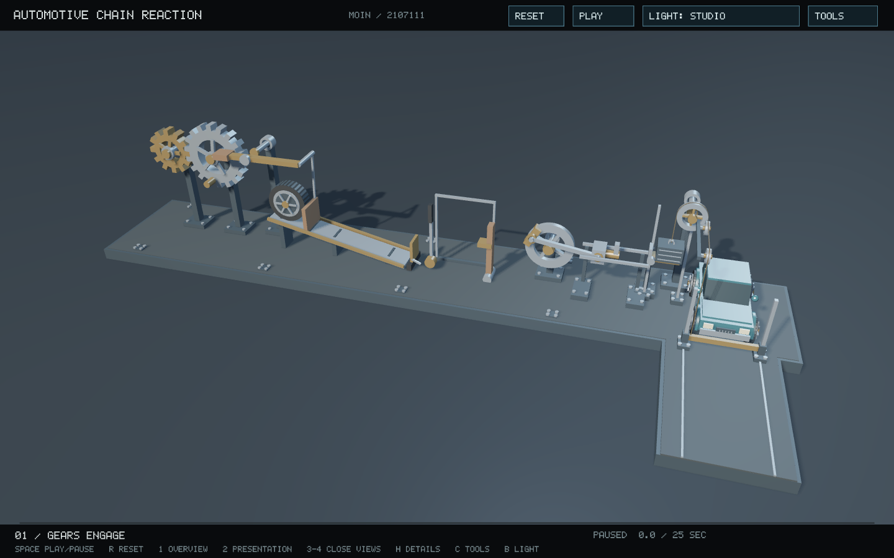

# 3D Automotive Chain Reaction

**Mohammad Moin Uddin Moin | Roll 2107111**

A complete 25-second OpenGL chain reaction, constructed from cubes, spheres and
procedural triangle meshes. The original gears, lever, wheel, wiper and tipping
bar now drive a crank/piston, release catch and counterweight-operated car barrier.
The car drives out with distance-based wheel rotation, then the scene holds for replay.



## Run

Double-click **cog_demo.exe**, or double-click **run.bat** to rebuild and run.
Use the current cog_demo.exe; main.exe is an older demonstration.

```powershell
mingw32-make build
.\cog_demo.exe
```

VS Code Ctrl+Shift+B also builds cog_demo.exe. Keep glfw3.dll beside the executable.
The existing Windows/MinGW, GLFW, GLAD and OpenGL 3.3 setup is preserved. No new
libraries, downloaded models, textures or physics engine are required.

## What changed

- Replaced three repeated domino panels with three different functional assemblies:
  a crank with a sliding piston, a hinged release catch, and a pulley/counterweight.
- Added a cable-driven barrier and the complete car departure.
- Created an L-shaped machine bench and a forward-facing car exit bay.
- Added hollow gear rings, bearing mounts, shafts, fasteners, guide rails and cable guides.
- Detailed the car with dark windows, pillars, wheel arches, hubs, grille and lamp geometry.
- Reduced the normal interface to a small title, playback/light buttons and stage indicator.
- Retained four lighting presets and three shading modes; the label now says Blinn-Phong.

The earlier working source and build settings are preserved in
[backups/before-unique-mechanisms.zip](backups/before-unique-mechanisms.zip).

## Chain and transformations

| Mechanism | Visible cause and effect | Main transformation |
|---|---|---|
| Two gears | Large gear's cam pin pushes lever | Opposite local Z rotations; 3:2 ratio |
| Lever and gate | Lever pulls the wheel stop down | Rotation about axle; linked translation |
| Wheel | Rolls down rails and pushes input paddle | Translation plus angle = distance/radius |
| Wiper | Blade strikes the tipping bar tab | Rotation about its base pivot |
| Tipping bar | Strikes an offset paddle on the crank | Bottom-pivot rotation |
| Crank and piston | Crank pin drives a rigid rod and sliding crosshead | Crank rotation, rod orientation, piston translation |
| Hinged catch | Piston head pushes tab; support finger withdraws | Local pivot rotation |
| Pulley and counterweight | Falling weight pulls the barrier upward through cable | Equal/opposite translations; pulley rotation |
| Barrier | Rises above car roof before car starts | Vertical translation |
| Car | Drives four units down the exit bay | Root translation, parent Y rotation, wheel child rotations |

There are 12 labeled main parts: two gears, lever, wheel, wiper, bar, crank,
piston, catch, pulley/weight, barrier and car. Supports and connectors are components.

## Controls

| Control | Action |
|---|---|
| Play/Pause button or Space | Pause/resume; replay after completion |
| Reset button or R | Reset every mechanism and pause |
| Left drag / mouse wheel | Orbit / zoom |
| 1 | Full overview, including the final car position |
| 2 | Closer presentation view of the new mechanisms |
| 3 | Gear, lever and wheel close-up |
| 4 | Counterweight, barrier and car close-up |
| H | Toggle numbered parts and detailed chain information |
| Tools button or C | Show/hide shadows, shading and brightness controls |
| Light button or B | Studio / Daylight / Sunset / Night |
| Shading button in Tools or L | Blinn-Phong / Flat / Gouraud |
| Brightness buttons in Tools | Adjust light exposure |
| Shadows button in Tools | Toggle actual directional shadow mapping |
| Click thin bottom progress line | Seek and pause |
| Left / right arrow | Pause and step 0.25 seconds |
| Minus / plus keys | Animation speed: 0.25x to 2x |
| Esc | Exit |

Playback starts automatically, finishes its movement at 22 seconds and holds the
ending until the 25-second sequence finishes. It stays there until replay/reset.
Changing lights, shading or the camera does not restart animation.

## Lighting and shading implemented

- Ambient sky/ground term, Lambert diffuse and Blinn-Phong specular highlights.
- Directional main light, distance-attenuated point fill and directional rear light.
- Metal-tinted specular highlights, matte supports/rubber and a distinct blue car.
- Actual depth-map shadows from the main light with a 5x5 filter and slope correction.
- Per-fragment Blinn-Phong, per-face flat normals, and Gouraud vertex lighting.
- Inverse-transpose normal matrix for non-uniformly scaled shapes.
- Exposure, Reinhard tone mapping and display gamma correction.

Only the main light casts shadows. This is a practical teaching renderer, not a
full physically based material system. Windows are opaque stylized glass; lamps
are geometry, not extra light sources. Contacts are authored time cues, not a
collision solver. The rod length, cable travel and wheel rolling are constrained
mathematically to keep their motion coherent.

## Source map

| File | Purpose |
|---|---|
| src/animation.h | Timeline, trigger times, poses and crank-slider equations |
| src/scene.h | Primitive assemblies, mounts, mechanisms and car hierarchy |
| src/math3d.h | Explicit vector/matrix operations |
| src/renderer.h | Triangle mesh generation, shaders and shadow mapping |
| src/lighting.h | Four lighting presets |
| src/hud.h | Small built-in font and button drawing |
| src/main.cpp | Input, camera, application loop, verification and captures |

## Verification

```powershell
mingw32-make test
.\cog_demo.exe --verify-playback
.\cog_demo.exe --capture docs/workshop-preview
```

CPU checks cover rod length, cable travel, wheel rolling, continuous motion,
trigger waits, catch withdrawal, roof clearance, reset/replay and button behavior.
The GPU playback check exercises the real input handlers and renders the full
25-second sequence in 751 frames. Capture mode saves 32 views of stage transitions,
lighting modes, shading modes and the ending, then exits.

Read [docs/PROPOSAL.md](docs/PROPOSAL.md) for the updated proposal and viva notes.
