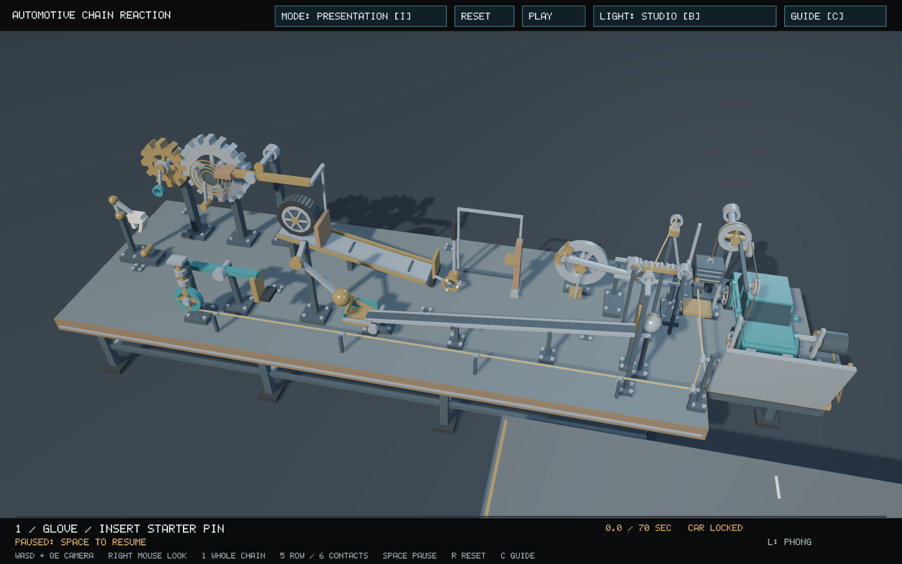
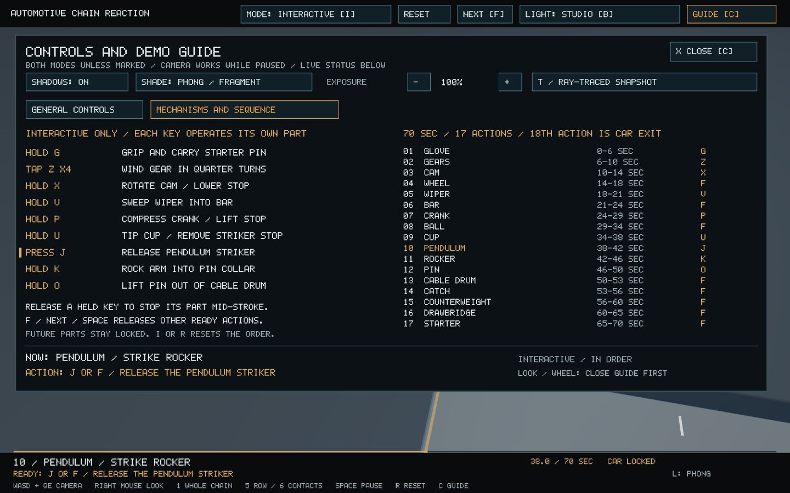

# Interactive Automotive Chain Reaction

**Mohammad Moin Uddin Moin | Roll 2107111 | Computer Graphics**

An OpenGL 3.3 machine made from cubes, spheres and generated triangle meshes. **Seventeen connected actions release the car at 70 active seconds.** The car exit is action 18. The gear winds once, the wiper sweeps once, and the crank makes one compression stroke. Five new parts occupy the front of the workbench: a rolling ball, trigger cup, pendulum striker, rocker arm and sliding pin. The pin frees a cable drum that withdraws the existing catch bolt.



## Build and run

```powershell
mingw32-make build
.\cog_demo.exe
```

Double-click **cog_demo.exe** to run, or **run.bat** to rebuild and run. Keep glfw3.dll beside the executable. main.exe is an older executable; the current build target is cog_demo.exe. The project keeps its MinGW, GLFW and GLAD setup and has no new dependencies or imported models.

Presentation starts automatically. The car unlocks at 70 seconds and drives onto the apron by 77 seconds. Press an arrow key after release to take over. It remains drivable after the automatic exit. **R, then Space** restarts presentation. **I** switches modes and resets all mechanisms, the car and queued inputs.

## Controls and Demo Guide

Click **Guide [C]** or press **C**. The **General Controls** tab lists camera, driving, playback, lighting and snapshot controls. **Mechanisms and Sequence** shows each individual operation, its place in the chain and its timing. Both tabs show the current mechanism and the available action. Close with **X Close**, **C**, or **Esc**. Buttons and mouse hit testing use the same bounds and scaling, including wide windows.



| Control | Effect | Mode |
|---|---|---|
| W / S | Move camera forward / backward | Both, including paused |
| A / D | Strafe camera left / right | Both, including paused |
| Q / E | Move camera down / up | Both, including paused |
| Left Shift | Hold for faster camera movement | Both |
| Hold right mouse | Free look; release restores pointer | Both, guide closed |
| Mouse wheel | Move closer / farther along view direction | Both, guide closed |
| 1 / 2 / 3 | Whole chain / crank and catch / glove and gears | Both |
| 4 / 5 / 6 | Car and apron / full front row / cup-striker-rocker-pin contacts | Both |
| Up / Down | Accelerate forward / brake and reverse | Both, after release, unpaused |
| Left / Right | Steer front wheels and chassis | Both, after release, unpaused |
| I / Mode button | Switch mode and reset mechanisms, car and inputs | Both |
| R / Reset button | Reset; presentation pauses, interactive becomes ready | Both |
| Space / Play-Pause button | Pause/resume current action and car; release a ready passive action | Both |
| F / Next button | Release the current passive mechanism; does not bypass a held or quarter-turn operation | Interactive |
| Hold G | Grip and transport the starter pin | Interactive, action 1 |
| Tap Z four times | Wind the gear a quarter turn per tap; key repeat is ignored | Interactive, action 2 |
| Hold X | Rotate cam and lower the wheel stop | Interactive, action 3 |
| Hold V | Sweep wiper into the clutch bar | Interactive, action 5 |
| Hold P | Compress crank, advance rack and lift the ball stop | Interactive, action 7 |
| Hold U | Tip the loaded cup and withdraw its retaining finger | Interactive, action 9 |
| J (or F) | Release the pendulum to strike the rocker | Interactive, action 10 |
| Hold K | Rock the arm into the sliding pin collar | Interactive, action 11 |
| Hold O | Withdraw the pin from the cable drum | Interactive, action 12 |
| C / Guide button | Open/close Controls and Demo Guide | Both |
| H | Toggle numbered part labels | Both |
| L | Switch real Phong / Gouraud shading | Both |
| B / Light button | Studio / Daylight / Sunset / Night | Both |
| Shading button | Cycle Phong / Flat / Gouraud | Guide |
| Shadows button | Toggle live and snapshot shadows | Guide |
| - / + buttons | Exposure, 40%-200% | Guide; these are mouse buttons |
| T / Snapshot button | Compute a ray-traced still of the current pose and view | Both |
| T / Esc / left click | Return from frozen snapshot and restore prior play/pause state | Snapshot |
| Esc | Close guide and release mouse look | Live OpenGL |
| Left click | Operate UI buttons and guide tabs | Both |
| Window X / Alt+F4 | Close application | All |

Releasing a held mechanism key stops that part at its actual partial pose. Press and hold again to continue. Space is a separate pause: resume with Space before continuing a held action. Future mechanism keys are ignored. F, Next and Space cannot complete a manual operation for you. At a boundary, the next stage requires fresh input; elapsed frame time cannot skip it. Camera controls use different keys from driving and mechanism controls.

## Sequence

Times below are active simulation seconds; interactive mode adds the user's waiting time. All seventeen durations sum to **70 seconds**.

| Action | Time | Duration | Visible transfer |
|---|---|---|---|
| 1. Glove | 0-6 | 6 s | Pick up the starter pin, insert it into the gear socket, withdraw hand |
| 2. Gears | 6-10 | 4 s | Wind the spring through one revolution |
| 3. Cam and lever | 10-14 | 4 s | Cam contacts lever and retracts the ramp stop |
| 4. Wheel | 14-18 | 4 s | Roll down the ramp and push the wiper trigger paddle |
| 5. Wiper | 18-21 | 3 s | One sweep contacts the tipping bar |
| 6. Clutch bar | 21-24 | 3 s | Tip onto the crank clutch pedal |
| 7. Crank and rack | 24-29 | 5 s | One compression stroke advances rack, lowers follower and lifts ball stop |
| 8. Rolling ball (new) | 29-34 | 5 s | Roll right to left into the trigger cup |
| 9. Trigger cup (new) | 34-38 | 4 s | Tip the captive ball away from the chute; withdraw striker retaining finger |
| 10. Pendulum striker (new) | 38-42 | 4 s | One arc strikes the rocker's lower paddle |
| 11. Rocker arm (new) | 42-46 | 4 s | Pivot to press the pin's release collar |
| 12. Sliding pin (new) | 46-50 | 4 s | Lift clear of the cable drum's stop tooth |
| 13. Cable drum and bolt | 50-53 | 3 s | Wind in the return cable and withdraw catch bolt |
| 14. Catch | 53-56 | 3 s | Swing clear of the supported weight |
| 15. Counterweight and barrier | 56-60 | 4 s | Weight falls, barrier rises, foot pedal releases bridge |
| 16. Drawbridge | 60-65 | 5 s | Lower across the exit gap and contact the starter trip |
| 17. Starter | 65-70 | 5 s | Turn once in 3 seconds, then retract coupling over 2 seconds |
| 18. Car exit | 70-77 | 7 s | Automatic departure in presentation; arrows drive in interactive |

The route moves left to right along the original rear row, then right to left across the ball/cup/striker/rocker row. A low, supported cable returns to the catch and car on the right. The closer overview, stepped workbench, legs and braces give both rows a readable setting. View 6 shows the new contacts closely; view 4 follows the driving area.

## Transformations for the new components

All matrices use column vectors: **world = T * R * S * local**. Cube scaling gives beams, beds, cup walls and brackets; spheres provide the ball, striker and joint rollers. Rings, disks and guide wheels are generated from triangles.

- **Ball:** translate along the inclined chute and rotate around Z by `distance / BALL_RADIUS`. Its off-center dark marker makes rotation visible. At arrival its center becomes a child of the cup, preserving its position continuously.
- **Cup:** `T(CUP_PIVOT) * Rz(angle)` rotates the floor, walls, retaining finger and captured ball together through 32 degrees. Its pivot is on the right so the ball tips left and down, clear of the chute.
- **Pendulum:** `T(PENDULUM_PIVOT) * Rz(angle)` swings a cube rod and sphere bob from +45 to -45 degrees at a fixed length of 1.65. It stops against the rocker and a damped rest.
- **Rocker:** pivot the beam and lower strike paddle about Z from 0 to -25 degrees. A short cross shaft carries the left roller to the pin collar in the front plane.
- **Sliding pin:** translate its shaft and collar upward by 0.65 along Y through two stationary guides. The freed drum rotates by cable take-up divided by its 0.42 radius, pulling the bolt along Z.

The rack's diagonal link keeps a fixed length using `sqrt(L*L-dx*dx)`. Its guided follower descends by the same amount that the ball stop rises, preserving cable length. The original crank also retains its fixed connecting rod length. Counterweight travel still equals barrier lift, and wheel rotation still follows signed driving distance.

## Rendering and simulation

Gouraud computes the lighting formula per vertex and interpolates the result. Phong interpolates normals/positions, normalizes the normal and evaluates the same formula per fragment. Flat shading uses face normals. Inverse-transpose normal transforms support nonuniform scaling. Four light rigs, a shadow map, exposure and matte/metal materials remain available.

T performs CPU ray/triangle intersections into the same scene, with a bounding-volume tree, shadow rays and one reflection bounce. The 800-pixel-wide result is a frozen snapshot. T, Esc or left click returns and excludes tracing time from the simulation clock. It is single-sample offline ray tracing with hard shadows.

This is deterministic, authored mechanism animation without a physics engine. Springs, latches and contact events explain the authored transitions; forces and collisions are not dynamically solved. The car uses kinematic steering, acceleration, drag, reverse and bounded driving surfaces.

## Validation

```powershell
mingw32-make test
.\cog_demo.exe --verify-playback
.\cog_demo.exe --verify-interactive
.\cog_demo.exe --verify-timing
.\cog_demo.exe --capture docs/expanded-preview
.\cog_demo.exe --capture-ray docs/expanded-ray
```

Playback verification renders the complete sequence. Interactive verification exercises the actual key callbacks, quarter turns and released holds while rendering all stages. Timing verification uses actual GLFW elapsed time for the full 77-second run. See [validation results](docs/VALIDATION.md) and [demonstration notes](docs/VIVA.md).

| File | Role |
|---|---|
| src/animation.h | Stage timing, deterministic poses, manual operations, free camera and driving |
| src/scene.h | Workbench, supports, original machine, new front row and car |
| src/main.cpp | GLFW handlers, guide, frame loop and verification/capture modes |
| src/hud.h | Triangle text/UI rendering and shared display/hit-test scaling |
| src/renderer.h | Primitive meshes, actual Gouraud/Phong shaders and shadow map |
| src/raytrace.h | CPU triangle ray tracer and snapshot display |
| src/validation.h | Timing, contacts, transforms, input, reset, car and UI checks |

Source before this change is preserved in backups/before-expanded-chain-2026-10-08.zip.
