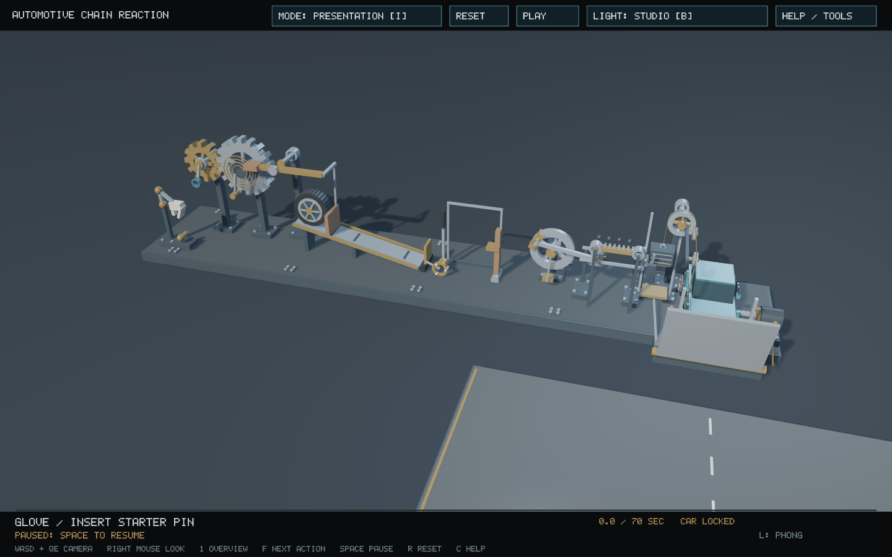
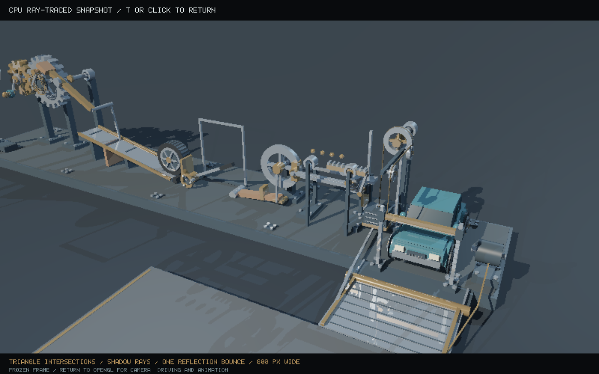

# Interactive Automotive Chain Reaction

**Mohammad Moin Uddin Moin | Roll 2107111 | Computer Graphics**

An OpenGL 3.3, Honda Cog-inspired machine made from cubes, spheres and generated triangle meshes. A **70-second mechanical sequence** releases a car you can drive. Twelve mechanisms can also be activated individually, in order, in interactive mode.



## Run

Double-click **cog_demo.exe** to run the built version. Double-click **run.bat** to rebuild and run. Keep glfw3.dll beside the executable. main.exe is an obsolete earlier build.

```powershell
mingw32-make build
.\cog_demo.exe
```

VS Code **Ctrl+Shift+B** builds the same cog_demo.exe. This preserves the existing MinGW, GLFW and GLAD setup; there are no new dependencies or imported models.

The presentation starts automatically. At 70 seconds the car unlocks, then automatically drives onto the apron over seven seconds. Press an arrow key after release to take over immediately. It remains drivable after the automatic departure finishes. Press **R**, then **Space**, to replay.

## Controls

| Key / button | Effect |
|---|---|
| WASD | Move camera forward/backward/left/right |
| Q / E | Move camera down / up |
| Hold right mouse button | Look around freely; release to use UI |
| Esc | Release mouse; return from a ray-traced snapshot |
| Shift | Faster camera movement |
| Mouse wheel | Move camera closer/farther along viewing direction |
| 1 | Restore machine overview |
| 2 / 3 / 4 | Pump and catch / gears and glove / car and driving apron |
| Up / Down arrows | Accelerate car forward / brake and reverse after release |
| Left / Right arrows | Steer car; front wheels visibly turn |
| I / Mode button | Switch presentation/interactive mode and reset machine/car |
| F / Next button | Activate the next ready mechanism in interactive mode |
| 5 / 6 / 7 / 8 / 9 | Activate pin / gears / lever / wheel / wiper when its turn is ready |
| Space / Play-Pause | Pause/resume; activate next action if waiting |
| R / Reset | Reset mechanisms and car; leave paused/ready |
| L | Compare **Phong and Gouraud** directly |
| B / Light button | Studio / Daylight / Sunset / Night |
| C / Help-Tools | Controls, shading, shadows, brightness, ray snapshot |
| Shading button in Tools | Phong / Flat / Gouraud |
| - / + buttons in Tools | Light exposure, 40%-200% |
| H | Numbered mechanism labels |
| T / Ray-traced snapshot button | Compute a still image; T, Esc or click returns |
| Window X / Alt+F4 | Close project |

Camera keys remain independent of driving keys and work while animation is paused. The old arrow-key timeline stepping, progress-bar seeking and playback-speed shortcuts were removed so they cannot bypass the release interlock. The progress bar is informational.

## Interactive demonstration

Press **I**, then **F**. The glove physically picks up and places the brass pin. When the prompt changes to READY, press F again to wind the gears. Repeat F for each action: cam/lever, rolling wheel, wiper, bar, pump/rack, bolt, catch, counterweight/barrier, bridge, starter. Each activation moves actual geometry. A later action cannot start until its predecessor finishes; pressing a future shortcut does nothing.

The twelve action durations total 70 active seconds in either mode. Interactive mode adds as much waiting time as you need between actions. Once released in interactive mode, the car waits for arrow input. Pause freezes the mechanisms and the car; camera and lighting inspection remain available.

## Timeline and transformations

| Active seconds | Mechanism and visible effect | Transformation |
|---|---|---|
| 0-6 | Glove transports designated pin from tray to starter socket | Hand translation, finger pivot rotations, temporary parent attachment |
| 6-18 | Gear pair winds exposed spring through four revolutions | Opposite Z rotations, 3:2 speed ratio; spring radius changes |
| 18-22 | Output cam lifts lever input; stop descends through ramp slot | Cam/lever local pivot rotations; gate translation |
| 22-26 | Loose wheel rolls down ramp to trigger paddle | Translation and rotation from distance/radius |
| 26-34 | Trigger enables two return sweeps and final extended wiper sweep | Wiper rotation, three-step index rotation, paddle translation |
| 34-36 | Bar tips onto crank clutch pedal | Bottom-pivot rotation; pedal translation |
| 36-50 | Crank pumps four revolutions plus final stroke; pawl advances rack four notches | Rotation, fixed-length rod orientation, piston/rack translation |
| 50-54 | Accumulated rack motion withdraws safety bolt | Z-axis bolt translation and link orientation |
| 54-57 | Catch support swings away from counterweight | Rotation about catch pivot |
| 57-60 | Weight descends, cable raises barrier, foot trips bridge | Opposite Y translations; pulley angle = cable travel/radius |
| 60-65 | Damped drawbridge lowers across actual exit gap | X rotation about hinge, changing support strut length |
| 65-70 | Starter turns engine, then shaft coupling retracts | Shaft axial rotation and translation |
| 70 onward | Car is released; automatic exit or keyboard driving | Chassis translation/Y rotation; wheel child rotation and steering |

The starter is active until the final second: there is no idle hold used to reach one minute. Rotating shafts, wiper indexing and ratchet increments occupy the longer stages. This is an authored mechanism animation, not a force/collision simulation. Some springs, pawls and telescopic links are visual explanations of timed state changes, not engineering-accurate mechanisms.

## Graphics implemented

Both Gouraud and Phong use the **same** ambient, Lambert diffuse and reflection-vector Phong specular formula, lights and materials. Gouraud evaluates it in the vertex shader and interpolates the lighting results. Phong interpolates transformed normals and positions, normalizes the normal, and evaluates lighting per fragment. Normals use the inverse-transpose model matrix, including nonuniform scaling. The optional Flat mode uses face normals.

Four light rigs contain a directional key, attenuated point fill and rear directional light. OpenGL shadows use a real 2048-square depth map with a 5x5 filter; only the key light casts shadows in that renderer. Metal-tinted highlights, matte rubber, exposure, tone mapping and display gamma are included. Windows are opaque stylized glass; headlights are geometry, not extra light sources.

For a viva comparison, press **3**, pause with Space, and press **L**. Compare the spherical glove joints and wheel hubs. Phong can retain a small highlight inside a triangle even when none of its vertices catches that highlight; Gouraud interpolates the vertex samples.

## Optional CPU ray tracing

Press **T** to trace the current camera and pose. This casts actual rays into the **same scene triangles**, finds nearest ray/triangle intersections with a bounding-volume tree, casts shadow rays toward lights, and traces one reflection bounce for reflective materials. The resulting **800-pixel-wide frozen snapshot** is displayed as a texture. A waiting message appears during calculation; rendering can take several seconds. T/Esc/click returns to OpenGL and restores the earlier play/pause state without advancing the simulation during tracing.

This is genuine offline ray tracing, not ray-traced real-time animation, a path tracer, or a label for the existing shadow map. It uses one sample per pixel, hard ray shadows and one reflection bounce. It has no denoising, refraction, global illumination or rough multi-ray reflections. Its sampling and shadow treatment differ from the live rasterized image.



## Implementation guide

| File | Purpose |
|---|---|
| src/animation.h | Stage boundaries, deterministic poses, glove attachment, free camera and car controller |
| src/scene.h | Primitive assemblies, supports, links, bridge, driving apron and car hierarchy |
| src/math3d.h | Column-major vectors/matrices and transformations |
| src/renderer.h | Triangle meshes, Gouraud/Phong shaders and shadow mapping |
| src/lighting.h | Four shared lighting presets |
| src/hud.h | Built-in font, buttons and labels |
| src/raytrace.h | Optional CPU triangle tracer and snapshot display |
| src/main.cpp | GLFW input, UI, actual-time loop and rendering |
| src/validation.h | CPU invariant checks and GPU input-handler checks |

The car uses a simple kinematic steering model with acceleration, drag and reverse. Wheel spin comes from signed chassis travel. The driving area is bounded; there is no full collision solver, suspension or individual inner/outer wheel differential.

## Validation and viva

```powershell
mingw32-make test
.\cog_demo.exe --verify-playback
.\cog_demo.exe --verify-timing
.\cog_demo.exe --capture docs/final-preview
.\cog_demo.exe --capture-ray docs/ray-preview
```

--verify-playback renders the complete timeline using synthetic time steps for fast verification. **--verify-timing uses actual GLFW elapsed time** and runs for about 77 seconds. It logs the first rendered frame at/after the 70-second release.

See [validation results](docs/VALIDATION.md), [viva guide](docs/VIVA.md), and [current draft/checklist](docs/PROPOSAL.md). The user confirmed that no proposal has been submitted; the YouTube video is a conceptual reference. The prior working source is preserved in [the backup](backups/before-final-requirements-2026-10-05.zip).
