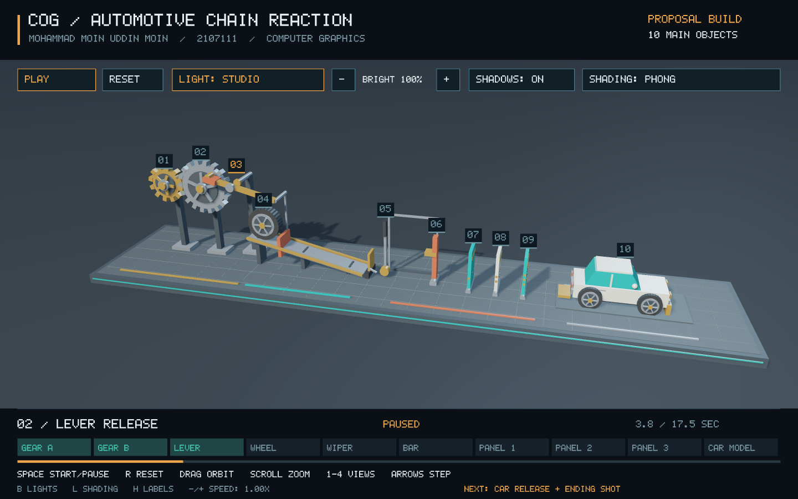

# 3D Automotive Chain Reaction

**Mohammad Moin Uddin Moin - Roll 2107111**  
Computer Graphics course project, inspired by the idea of Honda Cog.

This is the proposal milestone: ten main objects, an animated chain through the
first nine, and a modeled car ready for the final release stage. "70%" describes
the intended milestone, not a measured completion percentage. The car does not
drive in this build.



## Run

Double-click **cog_demo.exe** to run the compiled demo immediately.
Double-click **run.bat** to compile and run, or use:

```powershell
mingw32-make build
.\cog_demo.exe
```

The existing VS Code build task (Ctrl+Shift+B) also works. The installed compiler
is `C:/mingw64/bin/g++.exe`; IntelliSense now matches it. Keep `glfw3.dll` beside
the executable. No new packages, network connection, models or textures are needed.

Requires Windows, the existing MinGW compiler for rebuilding, GLFW, GLAD and
OpenGL 3.3. Runtime testing succeeded on Intel Iris Xe, OpenGL 3.3.0.

## Controls

| Control | Action |
|---|---|
| Play/Pause button or Space | Start / pause animation |
| Reset button or R | Reset and pause all animation |
| Left drag / mouse wheel | Orbit / zoom |
| 1 | Whole exhibit |
| 2 | Front view for inspecting contacts |
| 3 | Gears, lever and wheel close-up |
| 4 | Wiper, panels and car close-up |
| Left / right arrow | Pause and step backward / forward 0.25 seconds |
| Click bottom timeline | Seek to a time and pause |
| Minus / plus | Change speed (0.25x to 2x) |
| Light button or B | Cycle Studio / Daylight / Sunset / Night |
| Brightness - / + buttons | Adjust exposure from 40% to 200% |
| Shadows button | Toggle the main light's shadows |
| Shading button or L | Cycle Phong-style, flat and Gouraud shading |
| H | Toggle object labels |
| Esc | Exit |

Playback starts automatically and loops every 17.5 simulation seconds, including its final hold. Camera and
shading remain interactive while paused. Reset preserves camera, shading and speed.

## Ten main objects

1. Small gear
2. Large gear with cam pin
3. Lever assembly and retracting gate
4. Rolling wheel
5. Wiper assembly with input paddle and linkage
6. Tipping bar
7. First domino panel
8. Second domino panel
9. Third domino panel
10. Stylized car (stationary in this milestone)

Supports, axles, connectors, receiver and platform are component parts or scenery.
All geometry comes from triangles, scaled cubes and spheres. Circular solids are
triangle fans with triangle side walls. The cabin is a triangulated prism.

## Implemented

- OpenGL 3.3 core rendering, depth testing and multisampling.
- Procedural meshes with normals; no external assets or physics engine.
- Translation, rotation, scaling, local hinges and hierarchical car geometry.
- Time-based animation with overlapping stages and visible links.
- Distance-based wheel rotation and pitch-radius gear ratio.
- Perspective orbit camera and four presets.
- Four lighting presets with directional key light, attenuated point fill and rear rim light. Metal-tinted highlights, tone mapping and filtered directional shadows.
- Per-fragment Blinn-Phong (Phong-style), flat and Gouraud shading.
- Inverse-transpose normals for non-uniform scaling.
- On-screen status, labels, progress and pause/reset/scrub controls.

## Remaining final-project work

- Animate the receiver-to-car linkage and retract the car stop.
- Add the car's exit ramp, forward movement and distance-based wheel rotation.
- Tune all contacts and linkage motion at slow speed. Interactions are scripted
  approximations, not collision or rigid-body simulation.
- Add an optional ending camera shot and finalize the report/video.

## Source map

| File | Purpose |
|---|---|
| `src/main.cpp` | Application, camera/input, HUD contents, tests, screenshots |
| `src/math3d.h` | Vector/matrix operations and transformation conventions |
| `src/animation.h` | Timing, poses, stages and clock |
| `src/scene.h` | Primitive assemblies, materials, mechanisms and car |
| `src/renderer.h` | Meshes, shaders, shadow pass and BMP capture |
| `src/hud.h` | Built-in bitmap lettering and clickable button drawing |
| `src/lighting.h` | Four lighting rigs: colors, directions, exposure and shadow softness |
| `src/glad.c` | Existing OpenGL loader |

## Verification

```powershell
mingw32-make test
.\cog_demo.exe --capture docs/screenshots
```

CPU checks cover transformation order, fixed pivots, pause/reset, completion,
continuous animation, gear ratio, wheel rolling and paddle contact, and resting
panel spacing. They do not prove arbitrary collision correctness. Capture mode
renders 24 GPU frames at different times, viewpoints and shading modes, saves
BMPs and exits. Included PNGs are presentation copies of those captures.

See [the proposal and demonstration guide](docs/PROPOSAL.md) for tomorrow.

